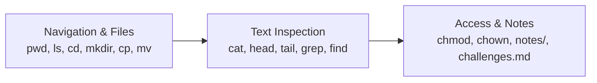

# Project 1: Linux Basics & Workspace Provisioning

**Core Linux CLI operations, workspace organization, file management, and text filtering with `grep`, `cat`, `head`, and `tail`.**

---

## 1. Architecture Overview

> [!IMPORTANT]
> **Key Design Decision:** Organized daily practice into structured files (`day1.txt`–`day3.txt`, `notes/`, `commands-used.md`, and `challenges.md`) so every command and troubleshooting step stays reproducible.

---

## 2. Problem & Solution

| Aspect | Detail |
| :--- | :--- |
| **Problem** | Navigating Linux filesystems, filtering large log outputs, and managing file permissions efficiently without a GUI. |
| **Solution** | Practiced core CLI navigation, command chaining with pipes, `grep` filtering, and permission basics on Ubuntu Linux. |
| **Cloud Relevance** | Every Cloud/DevOps engineer administers Linux servers daily (e.g., AWS EC2) and builds automation on shell primitives. |

---

## 3. Tech Stack
- **Operating System:** Ubuntu Linux
- **Shell & Tools:** GNU Bash CLI utilities (`pwd`, `ls`, `mkdir`, `cd`, `cp`, `mv`, `cat`, `grep`, `head`, `tail`, `find`, `chmod`, `chown`, `clear`)

---

## 4. Implementation Steps (Summary)
1. Practiced filesystem navigation and directory provisioning (`pwd`, `ls`, `cd`, `mkdir`).
2. Managed files safely with `cp` and `mv` across `day1.txt`, `day2.txt`, `day3.txt`, and `notes/`.
3. Filtered large outputs using `grep`, `head`, `tail`, and pipes, and documented commands in [commands-used.md](./commands-used.md).

<b>Click to expand Challenges & Solutions</b>

| Challenge | Solution |
| :--- | :--- |
| Wrong directory path | Verified current working directory with `pwd` before running file operations. |
| Large command output overflow | Filtered output using `grep`, `head`, and `tail`. |
| File permission issues | Fixed ownership and permissions using `chmod` and `chown`. |

---

## 5. Verification & Results
- **Deliverables:** [commands-used.md](./commands-used.md), [challenges.md](./challenges.md), and daily notes under `notes/`.
- **NextWork Reference:** [NextWork Project Document](https://nextwork.ai/refreshed_olive_vibrant_plum/docs/3d26053b-1b92-4c78-b105-95e1a4b32c2a)

---

## 6. Key Engineering Takeaways
- **Verify Location First:** Checking `pwd` before `cp`/`mv` prevents accidental file placement.
- **Pipes Save Time:** Combining `cat`/`grep`/`head`/`tail` isolates relevant lines from noisy logs in seconds.
