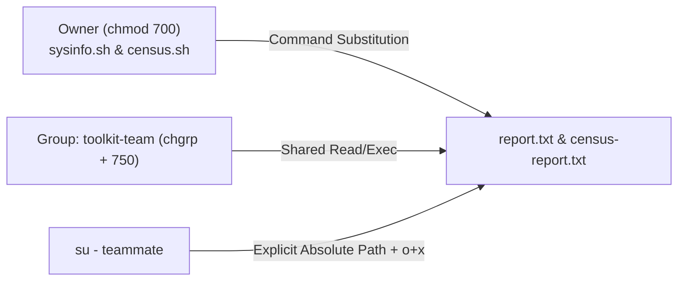

# Project 2: Control Your System & Privilege Governance (`admin-toolkit`)

**Linux identity management, multi-tenant DAC permissions (`chmod`, `chown`, `chgrp`, `sudo`), and automated telemetry scripts (`sysinfo.sh` & `census.sh`).**

---

## 1. Architecture Overview

> [!IMPORTANT]
> **Key Design Decision:** Applied `chmod 700` to sensitive administrative scripts and `chgrp toolkit-team` with `750` for shared engineering access, mirroring least-privilege isolation.

---

## 2. Problem & Solution

| Aspect | Detail |
| :--- | :--- |
| **Problem** | Shared Linux environments risk unauthorized script execution, broken relative paths (`~`) across users, and inconsistent system auditing. |
| **Solution** | Enforced DAC permissions (`chmod 700/750`, `chown`, `chgrp`), built `sysinfo.sh` & `census.sh` using `$(...)`, and standardized absolute paths (`/home/hisoka/...`). |
| **Security Boundary** | Administrative scripts locked to owner (`700`); shared collaboration scoped explicitly via `toolkit-team`. |

---

## 3. Tech Stack
- **Operating System:** Ubuntu Linux (WSL)
- **Scripting:** GNU Bash (`admin-toolkit/sysinfo.sh`, `admin-toolkit/census.sh`)
- **Security & Commands:** `whoami`, `id`, `uname -a`, `df -h`, `du -sh`, `free -h`, `top`, `ps aux`, `chmod 700/750`, `chown`, `chgrp`, `sudo`, `su - teammate`, `find`, `wc -l`

---

## 4. Implementation Steps (Summary)
1. Inspected user identities, group memberships, and hardware/resource usage (`id`, `df -h`, `free -h`, `ps aux`).
2. Applied least-privilege permissions (`chmod 700` on `sysinfo.sh` and `census.sh`, `chgrp` for `toolkit-team`).
3. Built `sysinfo.sh` and `census.sh` using command substitution `$(...)` to generate `report.txt` and `census-report.txt`.
4. Tested cross-user access (`su - teammate`) and resolved WSL filesystem read-only lock issues.

<b>Click to expand Challenges & Solutions</b>

| Challenge | Solution |
| :--- | :--- |
| Relative path `~/report.txt` failed after `su - teammate` | Used explicit absolute path (`/home/hisoka/devops-journey/...`) and granted parent traversal (`o+x`). |
| WSL Input/Output error dropping filesystem to Read-Only | Restarted WSL service via elevated PowerShell (`net stop LxssManager ; net start LxssManager`). |
| Unauthorized access risk to administrative scripts | Restricted script permissions to owner-only (`chmod 700 sysinfo.sh census.sh`). |

---

## 5. Verification & Results
- **Generated Reports:** `admin-toolkit/report.txt` and `admin-toolkit/census-report.txt`
- **NextWork Reference:** [NextWork Level 2: Control Your System](https://nextwork.ai/refreshed_olive_vibrant_plum/docs/d005387c-1f07-4574-af7a-975b712870d0)

---

## 6. Key Engineering Takeaways
- **Absolute Paths Across Users:** Never rely on `~` when sharing files or scripts across different Linux user accounts.
- **Linux DAC Mirrors Cloud IAM:** Enforcing `700`/`750` and group-based access on Linux builds the same least-privilege discipline used in AWS IAM.
