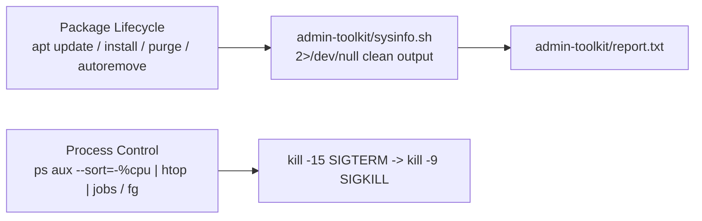

# Project 3: Software & Processes Governance (`admin-toolkit`)

**Automated `sysinfo.sh` telemetry, `apt` package lifecycle management, background jobs, and Unix signal handling (`SIGTERM` vs. `SIGKILL`).**

---

## 1. Architecture Overview

> [!IMPORTANT]
> **Key Design Decision:** Always attempt graceful termination (`kill -15` / `SIGTERM`) before forcing kernel termination (`kill -9` / `SIGKILL`), and suppress noisy `apt list` stderr warnings (`2>/dev/null`) to keep automated reports clean.

---

## 2. Problem & Solution

| Aspect | Detail |
| :--- | :--- |
| **Problem** | Orphaned package configs, terminal-blocking background tasks, CPU spikes, and noisy stderr warnings break automated health reporting. |
| **Solution** | Standardized `apt purge`/`autoremove`, background job control (`&`, `jobs`, `fg`), CPU sorting (`ps aux --sort=-%cpu`), and clean `sysinfo.sh > report.txt` pipelines. |
| **Operational Boundary** | Graceful `SIGTERM` (`-15`) first; `SIGKILL` (`-9`) reserved only for unresponsive processes. |

---

## 3. Tech Stack
- **Operating System:** Ubuntu Linux (WSL)
- **Package Management:** `apt` (`update`, `search`, `show`, `install`, `remove`, `purge`, `autoremove`)
- **Process & Signal Tools:** `ps aux --sort=-%cpu`, `htop`, `&`, `jobs`, `fg`, `kill -15` (`SIGTERM`), `kill -9` (`SIGKILL`)
- **Scripting:** GNU Bash (`admin-toolkit/sysinfo.sh`)

---

## 4. Implementation Steps (Summary)
1. Managed the full `apt` lifecycle including clean removal (`sudo apt purge` + `sudo apt autoremove`).
2. Audited top CPU consumers (`ps aux --sort=-%cpu | head -11`), monitored via `htop`, and managed background jobs (`&`, `jobs`, `fg`).
3. Practiced safe process termination escalating from `kill -15 <PID>` to `kill -9 <PID>` only when necessary.
4. Automated system telemetry output via `./sysinfo.sh > report.txt` with `2>/dev/null` stderr filtering.

<b>Click to expand Challenges & Solutions</b>

| Challenge | Solution |
| :--- | :--- |
| `apt list` warning polluting script output | Redirected stderr to null (`apt list --installed 2>/dev/null \| wc -l`). |
| Terminal blocked by long-running process | Ran asynchronously in background using `&` and managed with `jobs` / `fg`. |
| Unresponsive process ignoring normal close | Escalated from `kill -15 <PID>` (`SIGTERM`) to `kill -9 <PID>` (`SIGKILL`). |

---

## 5. Verification & Results
- **Generated Deliverables:** `admin-toolkit/sysinfo.sh`, `admin-toolkit/report.txt`, and `linux-lab3/folder-report.txt`.
- **NextWork Reference:** [NextWork Level 3: Software & Processes](https://nextwork.ai/refreshed_olive_vibrant_plum/docs/fdb1eb2a-54bf-49d7-baf8-a214e82405e2)

---

## 6. Key Engineering Takeaways
- **Clean Telemetry Pipelines:** Suppressing expected CLI warnings with `2>/dev/null` keeps downstream metrics (`wc -l`) accurate.
- **Graceful First:** `SIGTERM` lets applications flush state and close sockets cleanly; `SIGKILL` is the last resort.
