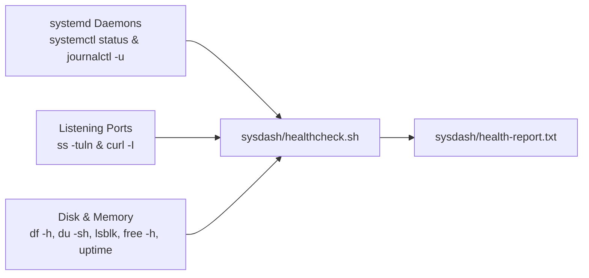

# Project 4: Network, Services & System Health (`sysdash`)

**Linux service management (`systemd`), listening socket auditing (`ss -tuln`), HTTP probing (`curl -I`), and automated `sysdash` health reporting.**

---

## 1. Architecture Overview

> [!IMPORTANT]
> **Key Design Decision:** Combining daemon state (`systemctl`/`journalctl`), open socket checks (`ss -tuln`), and disk/memory metrics into `sysdash/healthcheck.sh` accelerates incident triage when diagnosing unavailable services or full disks.

---

## 2. Problem & Solution

| Aspect | Detail |
| :--- | :--- |
| **Problem** | Silent daemon failures, misunderstood port protocols (e.g., DNS port 53 vs. HTTP), and hidden disk-space hogs slow down server troubleshooting. |
| **Solution** | Audited listening sockets with `ss -tuln`, inspected logs via `journalctl`, ranked disk usage (`du -sh ~/* \| sort -h \| tail -5`), and automated checks in `sysdash/healthcheck.sh`. |
| **Diagnostic Boundary** | `Connection refused` confirms no daemon is listening; `Empty reply` with `curl` indicates a non-HTTP protocol (like DNS on port 53). |

---

## 3. Tech Stack
- **Operating System:** Ubuntu Linux (WSL)
- **Service Manager:** `systemd` (`systemctl status`, `journalctl -u`)
- **Networking & Storage:** `ss -tuln`, `curl -I`, `ssh`, `df -h`, `du -sh`, `lsblk`, `free -h`, `uptime`

---

## 4. Implementation Steps (Summary)
1. Managed system daemons and inspected service logs using `systemctl status` and `journalctl -u`.
2. Audited listening ports and HTTP endpoints via `ss -tuln` and `curl -I`.
3. Pinpointed disk and memory usage with `df -h`, `du -sh ~/* | sort -h | tail -5`, `lsblk`, and `free -h`.
4. Built `sysdash/healthcheck.sh` to output `sysdash/health-report.txt`.

<b>Click to expand Challenges & Solutions</b>

| Challenge | Solution |
| :--- | :--- |
| Port 53 returned `Empty reply from server` with `curl` | Identified that Port 53 speaks `DNS` protocol, not `HTTP`. |
| Locating directories consuming excessive disk space | Used pipeline `du -sh ~/* \| sort -h \| tail -5` to rank top consumers. |
| Service failing silently in the background | Inspected daemon state and logs via `systemctl status` and `journalctl`. |

---

## 5. Verification & Results
- **Deliverables:** `sysdash/healthcheck.sh`, `sysdash/health-report.txt`, and [challenges.md](./challenges.md).
- **NextWork Reference:** [NextWork Level 4: Network, Services & Health](https://nextwork.ai/refreshed_olive_vibrant_plum/docs/9dc8053e-07e2-4a55-ac13-b90e9520d20b)

---

## 6. Key Engineering Takeaways
- **Ports & Protocols:** A listening port only responds to its expected protocol (`ss -tuln` shows what is open, `curl -I` tests HTTP).
- **Unified Health Checks:** Consolidating network, service, and disk checks into one script cuts troubleshooting time on EC2 instances.
