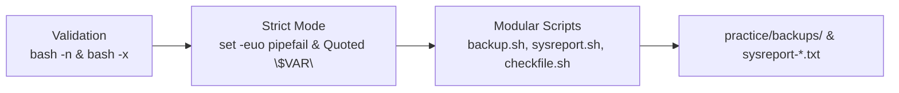

# Project 5: Advanced Bash Scripting & Automation

**Modular Bash automation scripts (`backup.sh`, `sysreport.sh`, `checkfile.sh`) using `set -euo pipefail`, CLI arguments, and `bash -n`/`bash -x` debugging.**

---

## 1. Architecture Overview

> [!IMPORTANT]
> **Key Design Decision:** Every script starts with `set -euo pipefail`, validates directories (`[ -d "$DIR" ]`), and quotes all path variables (`"$VAR"`) to fail fast rather than silently continuing after errors or breaking on spaces.

---

## 2. Problem & Solution

| Aspect | Detail |
| :--- | :--- |
| **Problem** | Unchecked Bash scripts continue running after failed commands, break on filenames with spaces, and lack pre-execution syntax validation. |
| **Solution** | Enforced `set -euo pipefail`, quoted variables (`"$VAR"`), validated syntax with `bash -n` and traced logic with `bash -x`, and built `backup.sh` (`tar -czf`) & `sysreport.sh`. |
| **Cloud Relevance** | Directly translates to reliable `AWS EC2 User Data` bootstrapping, CI/CD hooks, and automated backup workflows. |

---

## 3. Tech Stack
- **Operating System:** Ubuntu Linux (WSL)
- **Language:** GNU Bash (`#!/bin/bash`, `set -euo pipefail`, `$1`, `$2`, `$@`, `$?`)
- **Debugging & Archiving:** `bash -n`, `bash -x`, `tar -czf`, `gzip`, `chmod +x`

---

## 4. Implementation Steps (Summary)
1. Built core scripting primitives (`variables.sh`, `askname.sh`, `argdemo.sh`, `checkfile.sh`, `counter.sh`, `countfruit.sh`, `greeter.sh`).
2. Implemented `backup.sh` (`tar`/`gzip` archiving into `practice/backups/`) and `sysreport.sh` (timestamped reports).
3. Enforced fail-fast execution (`set -euo pipefail`) and validated scripts with `bash -n` and `bash -x`.

<b>Click to expand Challenges & Solutions</b>

| Challenge | Solution |
| :--- | :--- |
| Script continuing execution after a failed directory change | Added `set -euo pipefail` and explicit `[ -d "$DIR" ]` checks. |
| Unquoted paths breaking when filenames contain spaces | Wrapped all path variables in double quotes (`"$target_path"`). |
| Debugging silent logic errors inside loops | Used trace mode (`bash -x script.sh`) to inspect variable expansion step-by-step. |

---

## 5. Verification & Results
- **Scripts Directory:** `scripts/` (`backup.sh`, `sysreport.sh`, `checkfile.sh`, `inspect.sh`, etc.)
- **Generated Outputs:** `practice/sysreport-2026-10-15.txt`, `practice/report.txt`, and `practice/backups/`.

---

## 6. Key Engineering Takeaways
- **Fail Fast Always:** `set -euo pipefail` + quoted `"$VAR"` prevents subtle, destructive bugs in automation.
- **Dry-Check Before Run:** `bash -n` catches syntax issues safely without executing side effects.
