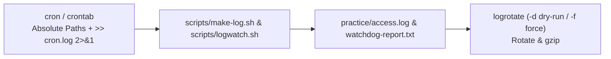

# Project 6: Automate Logs & Cron Scheduling

**Automated background scheduling with `cron` (`crontab`) and log lifecycle rotation with `logrotate` to prevent disk exhaustion.**

---

## 1. Architecture Overview

> [!IMPORTANT]
> **Key Design Decision:** Because `cron` runs with a minimal `PATH` environment, all scheduled scripts use explicit absolute paths (`/home/hisoka/...`), redirect `stdout`/`stderr` (`>> /path/cron.log 2>&1`), and `logrotate` configs are dry-run tested with `logrotate -d` before forcing rotation.

---

## 2. Problem & Solution

| Aspect | Detail |
| :--- | :--- |
| **Problem** | Scripts that work interactively fail silently under `cron` due to minimal `PATH`/relative paths, while unrotated logs eventually exhaust disk space. |
| **Solution** | Scheduled `logwatch.sh` & `make-log.sh` with absolute paths in `crontab`, started/verified `cron` via `/var/log/syslog`, and tested `logrotate` policies (`-d` and `-f`). |
| **Cloud Relevance** | Prevents disk-full outages on `AWS EC2` instances and controls `CloudWatch` / `EBS` storage footprint. |

---

## 3. Tech Stack
- **Operating System:** Ubuntu Linux (WSL)
- **Scheduling:** `cron` (`crontab -e`, `crontab -l`, `sudo service cron status`, `/var/log/syslog`)
- **Log Lifecycle & Compression:** `logrotate` (`logrotate -d`, `sudo logrotate -f`), `gzip`
- **Scripts:** `scripts/logwatch.sh`, `scripts/make-log.sh`

---

## 4. Implementation Steps (Summary)
1. Built `make-log.sh` and `logwatch.sh` to generate and analyze access logs (`practice/access.log`, `watchdog-report.txt`).
2. Configured 5-field `crontab` entries with absolute paths and output redirection (`2>&1`), and verified `cron` daemon execution in `/var/log/syslog`.
3. Validated `logrotate` policies using dry-run (`logrotate -d`) and forced rotation (`sudo logrotate -f`).

<b>Click to expand Challenges & Solutions</b>

| Challenge | Solution |
| :--- | :--- |
| Script works manually in terminal but fails inside `cron` | Replaced relative paths with absolute paths (`/home/hisoka/...`) and defined `PATH`. |
| `cron` daemon not running automatically in WSL session | Started and verified service via `sudo service cron start` and checked `syslog`. |
| Verifying `logrotate` config without waiting 24 hours | Used `logrotate -d` for dry-run validation and `logrotate -f` to force rotation. |

---

## 5. Verification & Results
- **Deliverables:** `scripts/logwatch.sh`, `scripts/make-log.sh`, `practice/watchdog-report.txt`, and [challenges.md](./challenges.md).

---

## 6. Key Engineering Takeaways
- **Cron Needs Explicit Context:** Always use absolute paths and log both `stdout` and `stderr` (`2>&1`) in `crontab`.
- **Test Rotation Safely:** Always run `logrotate -d` before deploying rotation rules to avoid accidental log loss.
