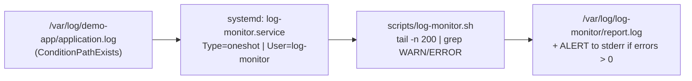

<div align="center">

# Project 7: Server Hardening & Log Monitor


**Ubuntu WSL training project: SSH & UFW hardening practice plus `log-monitor.sh` running as a sandboxed `systemd` oneshot service under user `log-monitor`.**

</div>

---

## 1. Architecture Overview



> [!IMPORTANT]
> **Key Design Decision:** Rather than running `log-monitor.sh` as `root`, `log-monitor.service` executes under a dedicated unprivileged `log-monitor` user/group with strict `systemd` sandboxing (`NoNewPrivileges`, `ProtectSystem=strict`, `ProtectHome=yes`, `PrivateTmp=yes`, `PrivateDevices=yes`, `UMask=0027`).

---

## 2. Problem & Solution

| Aspect | Detail |
| :--- | :--- |
| **Problem** | Monitoring scripts often run with excessive `root` privileges, while default SSH/firewall configs leave unnecessary attack surface. |
| **Solution** | Practiced SSH (`config/sshd-hardening.conf`) and UFW firewall rules, wrote `log-monitor.sh` to scan the last 200 lines for `level=WARN`/`level=ERROR`, and ran it via a hardened `systemd` oneshot service (+ timer/path/logrotate configs). |
| **Security Boundary** | Dedicated `log-monitor` user, `LogsDirectoryMode=0750`, `UMask=0027`, and kernel/filesystem protections (`ProtectSystem=strict`, `ProtectHome=yes`, `ProtectKernelTunables=yes`, `ProtectKernelModules=yes`, `ProtectControlGroups=yes`). |

---

## 3. Tech Stack
- **Operating System:** Ubuntu Linux (WSL)
- **Hardening & Firewall:** OpenSSH (`config/sshd-hardening.conf`), UFW
- **Automation & Service Control:** GNU Bash (`scripts/log-monitor.sh`), `systemd` (`log-monitor.service`, `log-monitor.timer`, `log-monitor.path`), `logrotate` (`config/log-monitor.logrotate`)

---

## 4. Implementation Steps (Summary)
1. Practiced general SSH hardening (`config/sshd-hardening.conf`) and UFW firewall rules on Ubuntu WSL.
2. Wrote `scripts/log-monitor.sh` (`set -euo pipefail`) to tail the last 200 lines of `/var/log/demo-app/application.log`, count `level=WARN` and `level=ERROR`, append a timestamped summary to `/var/log/log-monitor/report.log`, and emit `ALERT` on `stderr` when `error_count > 0`.
3. Configured `config/log-monitor.service` (`Type=oneshot`, `User=log-monitor`, `Group=log-monitor`) along with timer, path, and logrotate configs.

<details>
<summary><b>Click to expand scripts/log-monitor.sh & config/log-monitor.service</b></summary>

```bash
#!/usr/bin/env bash
set -euo pipefail

source_log="${SOURCE_LOG:-/var/log/demo-app/application.log}"
report_log="${REPORT_LOG:-/var/log/log-monitor/report.log}"
window_lines="${WINDOW_LINES:-200}"

if [[ ! -r "$source_log" ]]; then
  printf 'ERROR source log is not readable: %s\n' "$source_log" >&2
  exit 1
fi

recent_log="$(tail -n "$window_lines" "$source_log")"
warning_count="$(grep -c 'level=WARN' <<<"$recent_log" || true)"
error_count="$(grep -c 'level=ERROR' <<<"$recent_log" || true)"
timestamp="$(date --iso-8601=seconds)"
summary="$timestamp source=$source_log window_lines=$window_lines warnings=$warning_count errors=$error_count"

printf '%s\n' "$summary" | tee -a "$report_log"

if (( error_count > 0 )); then
  printf 'ALERT errors=%s source=%s\n' "$error_count" "$source_log" >&2
fi
```

```ini
[Unit]
Description=Scan the demo application log for warnings and errors
Documentation=man:systemd.service(5)
After=local-fs.target
ConditionPathExists=/var/log/demo-app/application.log

[Service]
Type=oneshot
User=log-monitor
Group=log-monitor
ExecStart=/usr/local/lib/log-monitor/log-monitor.sh
LogsDirectory=log-monitor
LogsDirectoryMode=0750
UMask=0027
NoNewPrivileges=yes
PrivateTmp=yes
PrivateDevices=yes
ProtectSystem=strict
ProtectHome=yes
ProtectKernelTunables=yes
ProtectKernelModules=yes
ProtectControlGroups=yes
```

</details>

---

## 5. Verification & Results
- **Deliverables:** `scripts/log-monitor.sh`, `config/log-monitor.service`, `config/log-monitor.timer`, `config/log-monitor.path`, `config/log-monitor.logrotate`, `config/sshd-hardening.conf`, and [challenges.md](./challenges.md).

---

## 6. Key Engineering Takeaways
- **Sandboxed Daemons:** Modern `systemd` directives (`ProtectSystem=strict`, `NoNewPrivileges`, dedicated service users) sharply reduce blast radius if a script is ever compromised.
- **Explicit Preconditions:** `ConditionPathExists` and `[[ ! -r "$source_log" ]]` fail cleanly with clear diagnostics instead of crashing obscurely.
