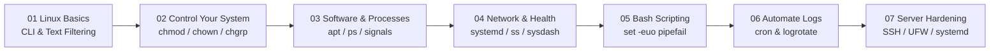

<div align="center">


# Linux & DevOps Engineering Journey (7 Hands-On Projects)


**Seven progressive Ubuntu Linux & Bash engineering labs covering CLI fundamentals, permission governance, process control, networking, cron/logrotate, and systemd hardening.**

</div>

---

## 1. Architecture Overview



> [!IMPORTANT]
> **Key Design Decision:** Built as a structured 7-stage progression on Ubuntu Linux (WSL2), moving from interactive CLI administration to modular, fail-fast Bash automation and sandboxed `systemd` services.

---

## 2. Problem & Solution

| Aspect | Detail |
| :--- | :--- |
| **Problem** | Cloud and DevOps workflows (AWS EC2, CI/CD, troubleshooting) fail quickly without strong Linux internals, permission discipline, and automation skills. |
| **Solution** | Completed 7 hands-on projects spanning filesystem navigation, DAC permissions, package/process governance, socket & health auditing, Bash scripting, `cron`/`logrotate`, and `systemd` hardening. |
| **Documentation Standard** | Root matrix links to each subproject's dedicated `README.md`, scripts, configs, and [cheatsheet.md](./cheatsheet.md). |

---

## 3. Tech Stack
- **Operating System:** Ubuntu Linux (WSL2)
- **Shell & Scripting:** GNU Bash (`set -euo pipefail`, `bash -n`, `bash -x`), `tar`/`gzip`
- **Networking & Services:** `systemd` (`systemctl`/`journalctl`), `ss -tuln`, `curl -I`, `ssh`, `ufw`
- **Security & Automation:** Linux DAC (`chmod`, `chown`, `chgrp`, `sudo`), `cron`/`crontab`, `logrotate`

---

## 4. Implementation Steps (7-Project Matrix)

| # | Project | Core Tech | Key Deliverable | Documentation |
| :-: | :--- | :--- | :--- | :-: |
| **01** | **[Linux Basics & Provisioning](./01-linux-basics)** | Ubuntu WSL, CLI Navigation, `cat`, `grep` | Filesystem navigation, directory hierarchy, and log filtering | [Project 01 README](./01-linux-basics/README.md) |
| **02** | **[Control Your System](./02-control-your-system)** | `chmod`, `chown`, `chgrp`, `sudo` | System audit scripts (`sysinfo.sh`, `census.sh`) & least-privilege permissions | [Project 02 README](./02-control-your-system/README.md) |
| **03** | **[Software & Processes](./03-software-and-processes)** | `apt` lifecycle, `ps aux`, `htop`, `SIGTERM`/`SIGKILL` | Package management & non-interactive health telemetry (`admin-toolkit`) | [Project 03 README](./03-software-and-processes/README.md) |
| **04** | **[Network, Services & Health](./04-network-services-health)** | `systemd`, `ss -tuln`, `curl -I`, `du`, `df` | Server health dashboard (`sysdash/healthcheck.sh`) & socket triage | [Project 04 README](./04-network-services-health/README.md) |
| **05** | **[Bash Scripting & Automation](./05-bash-scripting)** | GNU Bash, `set -euo pipefail`, `tar`/`gzip` | Modular scripts (`backup.sh`, `sysreport.sh`) with fail-fast handling | [Project 05 README](./05-bash-scripting/README.md) |
| **06** | **[Automate Logs & Cron](./06-automate-logs-cron)** | `cron`/`crontab`, `logrotate`, log analysis | Automated `logwatch.sh` scheduling & log rotation policies | [Project 06 README](./06-automate-logs-cron/README.md) |
| **07** | **[Server Hardening & Log Monitor](./07-harden-log-monitor)** | Ubuntu WSL, SSH, UFW, Bash, `systemd` | SSH & UFW practice + `log-monitor.sh` running under sandboxed `systemd` | [Project 07 README](./07-harden-log-monitor/README.md) |

<details>
<summary><b>Click to expand Global Technical Stack Tree</b></summary>

```text
├── Operating Systems:   Ubuntu Linux (WSL2)
├── Shell & Scripting:   GNU Bash (Modular Automation, Error Trapping, Cron Schedulers)
├── Networking & Ports:  TCP/IP, DNS, HTTP/HTTPS, SSH, ss, curl
├── Process & Daemons:   systemd (systemctl/journalctl), Signals (SIGTERM/SIGKILL), htop
├── Security & Access:   Linux DAC (chmod/chown/chgrp), sudo, UFW, SSH Hardening
└── Version Control:     Git & GitHub
```

</details>

---

## 5. Verification & Results
- All 7 subprojects include hands-on scripts, reports, and challenge logs verified on Ubuntu WSL2.
- Quick CLI reference maintained in [cheatsheet.md](./cheatsheet.md).

---

## 6. Key Engineering Takeaways
- **Defense-in-Depth:** Apply least privilege across files (`chmod 700/750`), `sudo`, firewall rules (`UFW`), and `systemd` service sandboxing.
- **Automate Safely:** Combine `set -euo pipefail`, absolute paths in `cron`, and dry-run checks (`bash -n`, `logrotate -d`) before production execution.
